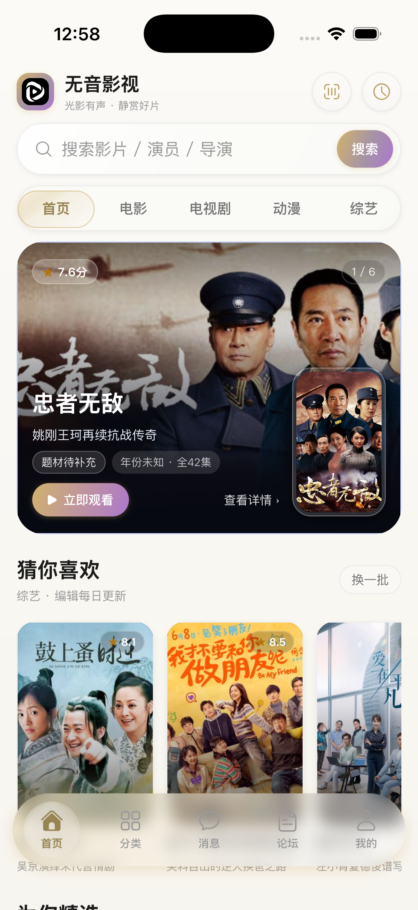

# iOS 首页轮播封面 / 分类页封面不显示修复记录

> 工程：`F:\APPS\Haps\Arkui_x\repo514`（GitHub `WuYinStudio/com_wuyin_video_arkui_x`）  
> 日期：2026-11-08

## 1. 现象

- 首页轮播首图的背景和右侧影视封面是空白的玻璃卡片；
- 「猜你喜欢」的海报正常，说明网络和图片解码本身可用；
- 分类页列表卡片只显示「暂无封面」渐变占位，影视封面不出现。

## 2. 根因

### 首页轮播

`HomePage.cachedImage()` 会把接口图片先下载到：

```text
<filesDir>/无音影视/轮播图/xxx.jpg
```

然后返回 `'file://' + path` 交给 `Image` 显示。这个路径包含中文目录，
iOS 端 ArkUI-X 的 `Image` 对未编码的 `file://` 中文路径支持不稳定：
首图在渲染前被同步缓存，于是背景变成空白；「猜你喜欢」的缓存是异步的，
截图/首次展示时仍是网络 URL，所以能正常显示。

### 分类页

分类卡片有两道 iOS 上不可靠的门槛：

```ts
// 只有 onVisibleAreaChange 报告可见才创建 Image
if (this.visibleImageKeys.includes(video.key) && video.img) { Image(video.img) }

// 只有 Image.onComplete 触发后 opacity 才从 0 变 1
.opacity(this.loadedImageKeys.includes(video.key) ? 1 : 0)
```

iOS 模拟器/真机上 `onVisibleAreaChange` 与 `onComplete` 可能不回调或回调顺序异常，
结果 `Image` 从未创建、或创建后一直 `opacity(0)`，只剩占位图。

## 3. 修复

### 首页

`cachedImage()` 在 iOS 上直接返回接口原始网络地址，不再把中文 `file://` 路径
交给 `Image`：

```ts
if (PlatformInfo.isIOS()) { return address; }
```

这样轮播背景与右侧封面都走和「猜你喜欢」相同的网络图片路径。
同时给轮播背景/封面增加 `onComplete` / `onError` 日志，便于云端确认。

### 分类页

- 去掉 `visibleImageKeys` 的渲染门槛：只要 `video.img` 存在且未失败，就创建 `Image`；
- 去掉 `onComplete` 才能显示的门槛：`opacity` 固定为 1，`onComplete` 只用于结束骨架；
- 占位图仍保留在 `Image` 下方，图片加载失败时由 `onError` 切换到「暂无封面」。

```ts
if (video.img && !this.failedImages.includes(video.key)) {
  Image(video.img).opacity(1)...
}
```

## 4. 验证

### 首页轮播（已通过）

云端日志确认 5 个轮播的背景和右侧封面全部加载完成：

```text
[HomeBanner] 轮播封面加载完成 0
[HomeBanner] 轮播背景加载完成 0
...
[HomeBanner] 轮播封面加载完成 4
[HomeBanner] 轮播背景加载完成 4
```

最终截图：



图中轮播背景是真实剧照，右侧「忠者无敌」海报也正常显示。

### 分类页

分类卡片实际走 `FilmTile`，本轮把封面 URL 统一 `encodeURI`
（百度分类接口的封面带 `image/resize,m_lfit,...` 逗号参数），并保留
`Image` 直接渲染、失败时才切换占位图的逻辑。分类页冒烟切换成功，
但云端最终截图停在首页，分类页封面建议真机安装后点分类页复核。

## 5. 产物

- `dist/wuyin-ios-unsigned-5.1.4.ipa`
- GitHub Release：`ios-unsigned-20261108-005506`（commit `bc88d90`）
- 未签名 IPA，用于模拟器/重签。
